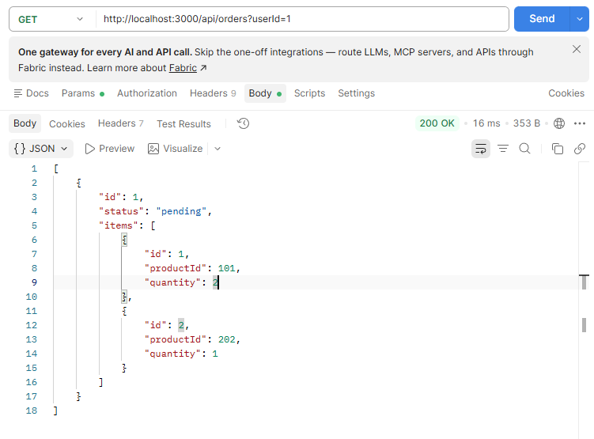
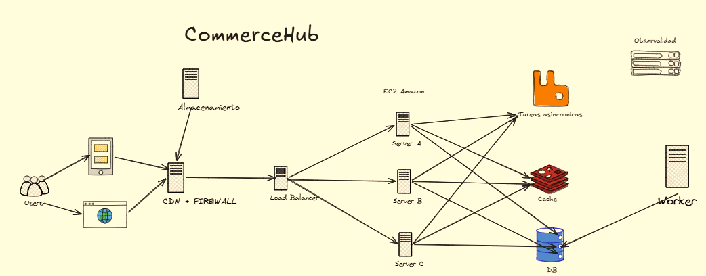
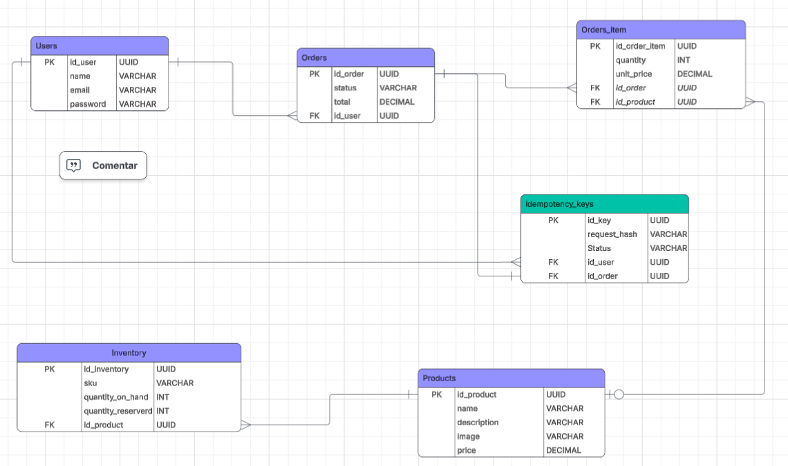
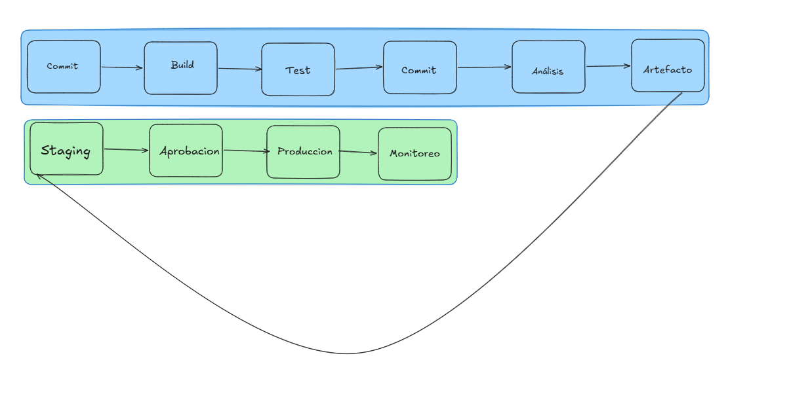

# Prueba Tecnica Fullstack Developer

## Seccion 1

### 1.1 Backend / API

```javascript
app.get("/api/orders", async (req, res) => {
  const userId = req.query.userId;
  const orders = await db.query(
    `SELECT * FROM orders WHERE user_id = ${userId}`,
  );
  for (const order of orders.rows) {
    const items = await db.query(
      `SELECT * FROM order_items WHERE order_id = ${order.id}`,
    );
    order.items = items.rows;
  }
  res.status(200).json(orders.rows);
});
```

### Problemas

- **Seguridad:** Sql Injection, validacion del parametro, Falta de autorizacion, Exposicion de informacion
- **Rendimiento**: Consultas en bucle, Consultas secuenciales
- **Mantenibilidad**: uso de SELECT \*
- **diseño de API**: Ausencia de paginacion

### Version Mejorada

[Abrir Codigo](./Seccion%201/app.js)

## Pasos para iniciar la aplicacion

Ingresa a la carpeta Seccion 1 Utiza este comando:

```bash
docker compose up --build -d
```

La aplicacion estara disponible en http://localhost:3600.

Para detenerla:

```bash
docker compose down
```

## URL

`GET http://localhost:3000/api/orders?userId=1`



### Inidices Necesarios

```sql
CREATE INDEX idx_orders_user_id_id ON  orders(user_id, id);
CREATE INDEX idx_order_items_order_id ON orders_items (order_id);
```

Crearia estos indices principalmente porque ayudan a obtener los datos de una manera mas rapida en los joins, evitando problemas de rendimiento

## 1.2 Frontend / React

```javascript
function ProductList({ api }) {
  const [products, setProducts] = useState([]);
  const [search, setSearch] = useState("");
  useEffect(() => {
    api.get("/products?search=" + search).then((response) => {
      products.push(...response.data);
      setProducts(products);
    });
  }, [search, products]);
  return (
    <div>
      <input value={search} onChange={(e) => setSearch(e.target.value)} />
      {products.map((p, index) => (
        <Product key={index} data={p} onClick={() => console.log(p)} />
      ))}
    </div>
  );
}
```

### Problemas

- Dependencias de useEffect incorrectas
- Ausencia de manejo de errores
- uso de index como key en lugar de un identificador unico
- mutacion directa del estado
- acumulacion de resultados duplicados y condiciones de carrera

### Evitar solicitudes excesivas

Utilizaria el **debounce** para evitar que se realicen solicitudes excesivas a el backend

### Respuestas

- **Respuestas fuera de orden**: Usaria AbortController para cancelar la peticion anterior cuando el usuario cambie la busqueda
- **Loading**: crearia u nestado loading con usState. lo activaria al iniciar la peticion y lo desactivaria al finalizar
- **Error**: implementaria un bloque try/cath para capturar errores y mostrar un mensaje de error
- **Cancelacion**: igual que la primera se utiliza AbortCOntroller para cancelar la peticiones http que ya sea necesarias

### Codigo propuesto

[Abrir Codigo](./Seccion%201.2/my-app/src/App.jsx)

## Pasos para iniciar la aplicacion

Ingresa a la carpeta Seccion 1.2 dentro de la carpeta my app, Utiza este comando:

```bash
docker compose up --build -d
```

La aplicacion estara disponible en http://localhost:3000.

Para detenerla:

```bash
docker compose down
```

## 1.3 SQL / datos

```sql
SELECT c.name,
 COUNT(o.id) AS orders,
 SUM(oi.quantity * oi.unit_price) AS revenue
FROM customers c
JOIN orders o ON o.customer_id = c.id
JOIN order_items oi ON oi.order_id = o.id
WHERE DATE(o.created_at) = '2026-10-01'
GROUP BY c.name
ORDER BY revenue DESC;
```

### Problemas

- Exactitud: una orden pueder tener varios productos en order_items
- Exactitud: La agrupacion de cleintes se realiza solo por el nombre
- Rendimiento: El uso de DATE() puede provocar un problema de rendimiento

### Reescribir la consulta

```sql
SELECT c.name,
COUNT(DISTINCT o.id) AS orders,
SUM(oi.quantity * oi.unit_price) AS revenue
FROM customers c
JOIN orders o ON o.customer_id = c.id
JOIN order_items oi ON oi.order_id = o.id
WHERE o.created_at >= '2026-10-01' AND o.created_at <  '2026-10-02'
GROUP BY c.id, c.name
```

### Indices

```sql
CREATE INDEX idx_orders_created_at ON orders (created_at);
CREATE INDEX idx_orders_customer_id ON orders (customer_id);
CREATE INDEX idx_order_items_order_id ON order_items (order_id)

```

Crearia estos 3 indices para evitar problemas de rendimientos ya que permiten consultar los datos y obtenerlos si ntener que verificar fila por fila

### Tabla orders millones de registro

Si la tabla tuviera millones de registro primer ocrearia los indices adecuados para evitar el problema de rendimiento para acelerar filtros y relaciones entre tablas

# 2 Caso de arquitectura

### Dibujo



### Flujo presionar "Pagar"

- Usuario presioan el boton "Pagar"
- Frontend manda la peticion al backend
- Backend valida los productos seleccionado y verifica que esten disponibles
- La Base de datos reserva el inventario creadon una orden con PENDING_PAYMENT de status
- El backend crea el pago con la pasarela de pago
- El usuario completa el pago
- Backend recibe el webhook con la respuesta del pago
- El estado de la orden pasa a confiarmada
- se notifica al usuario de la orden

### Componentes Principales

| Frontend                   | Interfaz de compra, Carrito, seguimiento de pedidos y panel adminsitrativo             |
| -------------------------- | -------------------------------------------------------------------------------------- |
| Backend                    | Reglas de negocio, APIs REST, inventario, pedidos, pagos e integraciones con pasarelas |
| Autenticacion              | Registro, Inicio de sesion y emision de tokens                                         |
| Datos                      | Persistir usuarios,productos,stock,reservas,ordenes y estado de pago                   |
| Cache                      | Acelerar lecturas frecuentes y reducir la carga de la base de datos                    |
| Mensajeria                 | Desacoplar tareas asincronicas del flujo                                               |
| Almacenamiento de imagenes | Guardar imagenes de productos y distribuirlas                                          |
| observabilidad             | Recopilar logs,metricas,trazas                                                         |

### Consistencia

| Consistencia Fuerte | Eventualmente Consistentes |
| ------------------- | -------------------------- |
| Inventario          | Reportes                   |
| Pagos               | Cache de productos         |
| Estado de la orden  | Notificaciones             |

### Evitar overselling, Cobros Duplicados y procesamiento duplicado de web hooks

- **Overselling:** Evitaria el overselling con reservas de inventario
- **Cobros Duplicados:** Para evitar cobros duplicados crearia una key de idempotencia por inteto de pago
- **Web Hooks Duplciados:** Para evitar los web hooks duplicado primero verificaria la firma para comprobar que viene de la pasarela y luego registraria en al base de datos el identificador unico y el back verifica si es el mismo que accion realizar y cuando finalize registra el evento como procesado y si el evento ya fue procesado simplemente lo ignoraria

### Estrategia para escalar y recuperarse de Fallas

Pues la estrategia mas comun hoy en dia es utiliza escalado Horizontal utilizando lo servicios Cloud asi mismo tendria varias replicas atras de una balanceador de carga para distribuir eficientemente el trafico

### Monolito modular

Principalmente haria todo en un monolito modular y posteriormente iria separando servicios como notificaciones,catalogo,pagos, inventarios y ordenes sucesivamente cuando lo requieran

### Nube y 5 desiciones tecnicas

Seleccionarai aws como cloud porque ofreces servicios necesarios para llevar a cabo la arquitectura y las 5 deciones tecnicas que tomaria:

- un escalado horizontal aprovechando la infrastructura de aws con ECS,
- Utilizar el servicio Amazon RDS con postgreSQQL
- Redis y CDN para reducir latencia
- Amazon SQS para procesamiento asincronicos como notificaciones,correos,etc
- Configuraria servicios como AWS WAF, IAM con privilegios minimos y otros mas para detectar fallos,proteger credenciales, investigar incidentes y recuperar el servicio

# 3 Implementacion Backend

## Diagrama



[Abrir Codigo](./Seccion-3/src/)

## Pasos para iniciar la aplicacion

Ingresa a la carpeta Seccion 3 dentro de la carpeta Utiza este comando:

```bash
docker compose up --build -d
```

La aplicacion estara disponible en http://localhost:8080.

Para detenerla:

```bash
docker compose down
```

## URL

`POST http://localhost:18081/api/v1/orders/11111111-1111-1111-1111-111111111111`

## Request Body

```json
{
  "items": [
    { "productId": "aaaaaaaa-aaaa-aaaa-aaaa-aaaaaaaaaaaa", "quantity": 2 }
  ]
}
```

## Headers

```
Idempotency-Key: 9f1c2b7e-3a4d-4e5f-8a6b-1c2d3e4f5a62
```

### Pago externo

Integrado el proveedor de pagos, mediante webhooks una vez creada la orden de pago se puede cerrar la conexion de base de datos y luego cuando la pasarela de pago devuelva el evento webhook, se valida y se guarda lo necesario en la db

# 4 Frontend y experiencai de usuario

### Estados UI

- **idle**: Direccion, productos y total editables
- **Validando**: validacion local de direccion y carrito
- **Enviando**: "Procesando tu pago", formulario en solo lectura
- **Confirmado**: Resumen de la orden con su id
- **Error recuperable**: "Algo fallo, puiedes reintentar de nuevo"
- **Error Corregible**: Que fue lo que fallo\_: stock insuficiente, precio cambiado
- **Error definitivo**: Sesion vencida, producto que no existe

### Perdida de conexion

Antes de enviar se guarda en sessionStorage la key, el contenido del carrito y el estado enviado, si no hay respuesta, se reintenta con la misma key varias veces, si el servidor resuelve la duda hay conexion njuevamente, si agota los intentos, le regresa un errores para que lo vuelva a intentar

### Doble click

La forma mas sencilla de bloquear el doble click es con un flag, que la primera vez que el usuario de click se coloque com overdadero y ya la segunda vez no podra pasar y luego que finalize la accion se vuelve a false para que pueda volver a presionar

### Accesibilidad

- Cada campo con `<label for="...">` visible
- usar type,autocomplete e inputmode correctos
- maracar como obligatorios los campons que asi sean
- Mensajes de error junto al campo
- Texto claro que diga que corregir
- Texto descriptivo: "Pagar xxxx" en lugar de Enviar

### Estados

- **local** colocaria los estados que solo necesita la pantalla como valores del formulario, errores de vlaidacio nde campo y si un modal esta abierto
- **Global** : Colocaria los estados que varias pantallas necesitan, como por ejemplo usuario autentica, temas etc
- **Server state**: Colocaria los datos que viene del backend, catalogo de productos,precios,ordenes,historial

# 5. Testing, Seguridad y diagnostico

### Pruebas

| Pruebas     | Verificacion                         |
| ----------- | ------------------------------------ |
| Unitaria    | Calculo del total                    |
| Unitaria    | Hash del request                     |
| Unitaria    | Validacion de los datos              |
| Integracion | Creacion exitosa completa            |
| Integracion | Idempotencia, mismo key y mismo body |
| Integracion | Mismo key con body distinto          |
| Integracion | Stock insuficiente                   |
| Integracion | Concurrencia                         |

### Seguridad

Los riesgos mas relevantes serian el Broken Access Control, El sql injection y identification and authenticacion failures

### Incidente

Principalmente generaria una hipotesis inicial de que la lentitud del proveedor alarga el tiempo en la que ocurren reintos, algun servicio esta reenviando la peticion y la idempotencia no la esta detectando toca averiguar donde nace el segundo intento y porque esta fallando la duplicacion, lo primero que haria es verificar los datos, despueis intentar hacer una linea del tiempo para ver que esta pasando realmente

### Datos

Para Realizar este cambio usaria el patron Expand/Contract, porque me permite den el despliegue tener dos version una vieja y nueva del back sobre la base de datos y ambas funcionan en todo momento, primero se agrega la columna nueva si ntocar la vieja y copio los datos existentes por lotes

# 6 DevOps y operación

### CI/CD



### Linting

- **Linting:** En el CI en cada pull request
- **Pruebas:** Cada prueba unitaria y de integracion en el CI
- **Analisis de dependecias:**: en el ci por cada pr
- **Build:** en el ci tras pasar las pruebas
- **Migraciones:** en el cd

### Estrategia Rollback

Una estrategia que usar seria la de Expand/Contract y ir haciendo cambios gradualmente entre el viejo y el nuevo para evitar errores y si algo falla solo desplego la verison atnerior

### Secretos

En local los colocaria en una archivo.env y en CI/CD los secretos van cifrados en el pipeline, con alcance por el entorno y en produccion usar un gestior de secretos como aws Secrets Manager

### Metricas

Las metricas y alerrtas que consideraria serian la latencia, el trafico, errores,saturacion y insfraestructura

# 7 Comunicación técnica

La decision mas riesgosa es concentrar inventario,ordenes y reservas en una unica base de datos, accedida pro tres servdidores. garantiza consistencia fuerte, evalue principlamente dividir el sistem en microservicios con base de datos propia, pero la descarte porque añaden complejidad en el desarollo y sin una necesidad demostrada, para confirmar si mi decision es correcta necesarias pruebas de estres que simulen el pico de 8000 usuarios concurrentes
